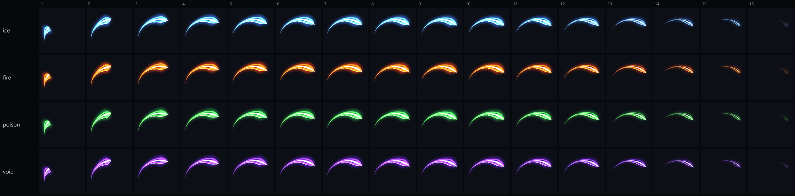

<p align="center"></p>

<h1 align="center">YujiPhoto</h1>

<p align="center">
  <b>A PhotoCraft fork built for Roblox VFX.</b><br>
  Draw every slash, hit, aura and explosion with code: shape by shape, in white tintable layers,<br>
  as animated flipbooks that are checked, previewed in colour, uploaded and played in game.
</p>

<p align="center">
  
  <br><sub>One drawing, every element: the same four white layers tinted ice, fire, poison and void, 16 frames.</sub>
</p>

## What's in it

- **The full PhotoCraft editor** (layers, masks, vectors, filters, PSD, 500+ commands, an MCP server),
  kept in sync with [storytold/photocraft](https://github.com/storytold/photocraft).
- **[`roblox/`](../roblox/README.md): the Roblox VFX toolkit (`yuji-vfx`)**, as a CLI and an MCP server:
  - generator scripts that draw effects frame by frame (`roblox/examples/slash.mjs`, `burst.mjs`)
    with helpers for asymmetric arcs, tapered strokes, tears along the flow and speed rips
  - flipbook atlases in Roblox's layout (1024², Grid2x2 / 4x4 / 8x8)
  - a quality gate: 4 px edge margin, white-layer check, dark fringes, red "blood" drops
  - tinted previews (contact sheet + GIF) so the AI and you can judge the result
  - Open Cloud upload (Image assets) and Luau generation
  - `YujiFlipbook.luau`, the in-game runtime (flat plate on the swing, or particles)
  - a Claude Code skill with the rules and workflow

## Quick start (Windows)

```powershell
git clone https://github.com/yuji123544/YujiPhoto
cd YujiPhoto
powershell -ExecutionPolicy Bypass -File roblox\scripts\install.ps1 -Build
node roblox\src\cli.mjs build roblox\examples\slash.mjs
```

Then ask your AI: *"make a new slash called wind_cut, thinner and longer, and show me the preview"*.
Full guide: [roblox/README.md](../roblox/README.md).

## Staying up to date

```powershell
powershell -ExecutionPolicy Bypass -File roblox\scripts\update.ps1
```

Merges the latest PhotoCraft, rebuilds, reinstalls and pushes to this fork. Roblox work lives only in
`roblox/` (and this file), so merges stay clean.

## Credits and licence

YujiPhoto is a fork of [PhotoCraft](https://github.com/storytold/photocraft) by Storyteller and its
contributors, dual-licensed MIT OR Apache-2.0 like the original (see `LICENSE-MIT`, `LICENSE-APACHE`,
`NOTICE`, `ATTRIBUTION.md`). The engine's own README is [`README.md`](../README.md). Changes made in
this fork: the `roblox/` folder, this page, the app icon (`assets/app-icon/`, drawn by
`roblox/scripts/make-icon.mjs`) and the visible app name (`crates/ui-egui/src/yuji_brand.rs`, used by
the window title, start screen, menus and About; crate names, binaries and the settings folder stay
`photocraft` so updates merge cleanly). YujiPhoto is not affiliated with Storyteller or Roblox.
